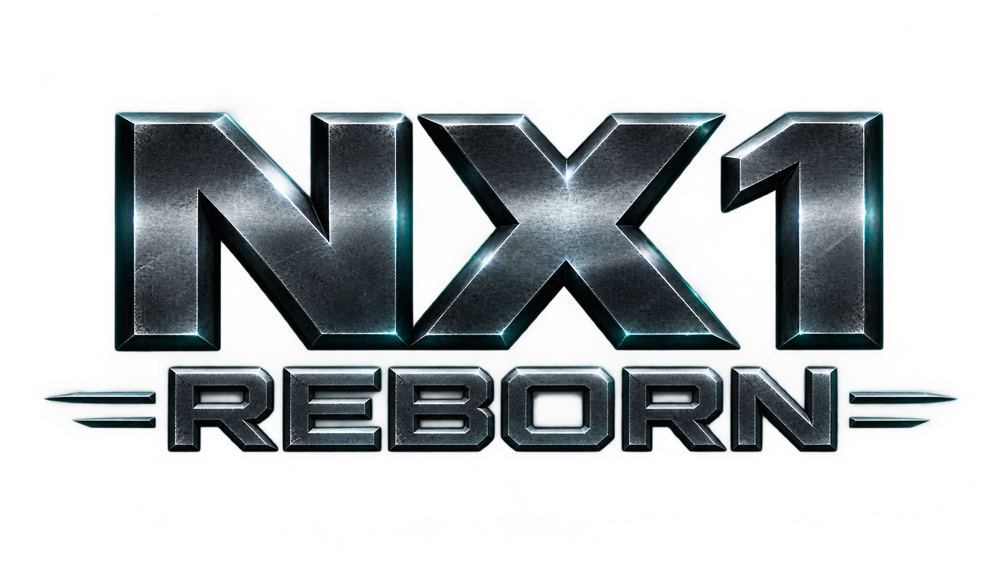

# NX1 Reborn

[](LICENSE)
[]()
[]()

A static recompilation of **Call of Duty: Future Warfare** (NX1) into native Windows executables.

PowerPC code is translated ahead of time into C++ and compiled. Xenos shaders are converted to HLSL and run on a real GPU driver. This is a maintained fork of [NX1recomp](https://github.com/goshavindtburg/NX1recomp) with local work on netplay, a native D3D9 path, shader cache, and supporting tooling.

<div align="center">
  
</div>

---

## Progress

| Area | Status | Notes |
| --- | --- | --- |
| Single-player (`nx1_sp`) | Bootable | ReXGlue graphics + developer overlay |
| Multiplayer (`nx1_mp`) | Bootable | Native D3D9 renderer |
| Netplay | Working | Client stutter fixed (v0.9) |
| Maps (`.ff`) | 15 loadable | Real bulk half present |
| Maps (`.ffm` only) | 12 invisible | Runtime has no `.ff` → `.ffm` fallback |
| Shader cache | Native | SM3 transform + `fxc` backend |
| Discord presence | Present | Requires Discord Social SDK |

---

## Missing files

This repository does not contain the game or its build dependencies. You must supply:

| Path | What it is | Where to get it |
| --- | --- | --- |
| `nx1/` | Game dump (`.xex` + assets) | Internet Archive v1.1.1.14 build |
| `generated/` | C++ from ReXGlue | Run ReXGlue against your dump |
| `thirdparty/` | Vendored trees | Restore from upstream commit `e8ce24f` |
| Discord SDK | Rich presence | Discord Social SDK |

Earlier or incomplete dumps are missing bulk data for several maps. Place the files from the v1.1.1.14 build in `nx1/` before building or running.

---

## Building

Requires CMake and Clang 20.1.8 (MSVC ABI). Each target is a standalone CMake project. Builds land in `out/build/win-amd64-release/`.

**Restore `thirdparty/` before building.** Those trees are gitignored. They are not fully recoverable from the committed `.gitmodules` — 11 non-submodule vendored trees plus the aggregator `CMakeLists.txt` must be obtained from upstream commit `e8ce24f`.

You also need a game dump in `nx1/` and must run ReXGlue to produce `generated/`.

---

## Layout

```
nx1_sp/           Single-player target
nx1_mp/           Multiplayer target (native D3D9 renderer)
rexglue-sdk/      ReXGlue SDK — vendored with NX1-specific changes
XenosRecomp/      Xenos shader → HLSL recompiler — vendored with NX1-specific changes
tools/            Dev scripts
res/              Icon and logo
```

`rexglue-sdk` and `XenosRecomp` are modified forks. Local work includes the netplay stack, native shader cache, Discord presence, debug HUD, and mouse-look on the SDK side; and the Shader Model 3 transform plus an `fxc` compiler backend on the XenosRecomp side.

---

## Contributing

Issues and pull requests are welcome. See [CONTRIBUTING.md](CONTRIBUTING.md) for scope and constraints.

- Runtime fixes, netplay improvements, and renderer work are in scope.
- Do not commit game code, assets, or generated C++.
- Include the target, dump version, and logs when reporting issues.

---

## Credits

Built on the work of others:

- **ReXGlue** — recompiler and runtime SDK
- **XenosRecomp** (hedge-dev) — Xenos shader recompilation
- **Xenia** — foundation for the above

Their respective licenses apply to the vendored copies.

---

## Legal Disclaimer

This repository contains **only** the recompilation harness, runtime glue, and local modifications. It does **not** contain any game code, assets, textures, models, sound, or other copyrighted material from Call of Duty: Future Warfare or any other title.

You must legally obtain your own dump of the original game. This project is not affiliated with, endorsed by, or sponsored by Activision, Treyarch, or any rights holder. All trademarks and copyrights remain the property of their respective owners.

Use of this software is at your own risk. The authors provide no warranty and accept no liability for any damages, legal consequences, or other issues arising from its use.

---

## License

The recompilation harness and local modifications in this repository are licensed under the [MIT License](LICENSE).

Vendored third-party components (ReXGlue, XenosRecomp, and their dependencies) retain their original licenses. See the respective directories for details.

Game code and assets are **not** included and are not licensed by this project.

See also: [Code of Conduct](CODE_OF_CONDUCT.md) · [Security Policy](SECURITY.md)
